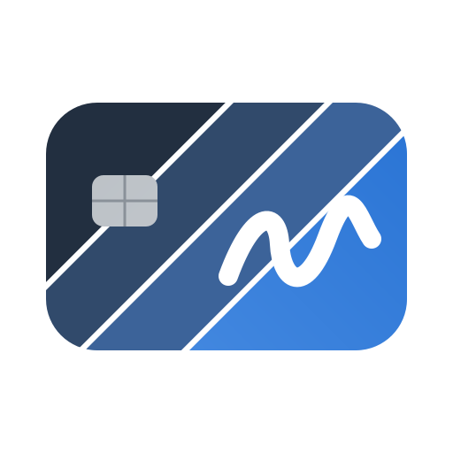

<p align="center">
  <picture>
    <source media="(prefers-color-scheme: dark)" srcset="docs/img/logo-dark.svg">
    
  </picture>
</p>

<h1 align="center">SignBridge</h1>

<p align="center">
  <b>Podpis kwalifikowany kartą lub tokenem w sesjach pulpitu zdalnego (RDP / RDS)</b><br>
  <i>Qualified e-signatures with a local smart card inside Remote Desktop sessions</i>
</p>

<p align="center">
  
  
  
  
</p>

<p align="center">
  <a href="#polski">Polski</a> · <a href="#english">English</a>
</p>

---

<a id="polski"></a>

## Czym jest SignBridge

SignBridge pozwala podpisywać dokumenty **kartą kwalifikowaną lub tokenem włożonym do własnego komputera**,
pracując w programach uruchomionych na **serwerze pulpitu zdalnego** (RDP / RDS).

Karty do podpisu kwalifikowanego często nie działają w sesjach RDP na nowszych wersjach Windows Server:
Windows widzi przekierowany czytnik, ale oprogramowanie dostawcy karty go nie znajduje.
SignBridge omija przekierowanie kart całkowicie.

Program jest **bezpłatny i otwarty** (licencja MIT).

## Dla kogo

* Firmy i biura rachunkowe pracujące w programach (np. księgowych, kadrowych, czytnikach PDF) uruchomionych
  na serwerze pulpitu zdalnego, które podpisują dokumenty kartą kwalifikowaną na komputerze pracownika.
* Administratorzy, którzy chcą wdrożyć podpis w RDS bez otwierania portów i zmian w sieci (GPO / Intune / MSI).

## Jak działa (w skrócie)

```
  SERWER (RDS)                                       KOMPUTER UŻYTKOWNIKA
  ┌──────────────────────────┐                      ┌──────────────────────────┐
  │ program księgowy / PDF   │                      │  mstsc + wtyczka         │
  │   │ "podpisz skrót"      │                      │  SignBridge              │
  │   ▼                      │   kanał wirtualny    │   │ NCryptSignHash       │
  │ Windows CNG              │        RDP           │   ▼                      │
  │   │                      │ ◄══════════════════► │ Windows CNG              │
  │   ▼                      │  (skrót → podpis)    │   │                      │
  │ dostawca kluczy (KSP)    │                      │   ▼  PIN lokalnie        │
  │ SignBridge               │                      │ karta / token / chmura   │
  └──────────────────────────┘                      └──────────────────────────┘
```

1. **Na serwerze** dostawca kluczy Windows (CNG KSP) pokazuje programom certyfikat użytkownika jak zwykły
   certyfikat z kluczem. Gdy program prosi o podpis, **sam skrót** trafia przez sesję RDP do komputera użytkownika.
2. **Na komputerze użytkownika** wtyczka klienta pulpitu zdalnego (mstsc) prosi lokalny Windows o podpis kartą
   — PIN wpisuje się w oknie sterownika karty — i odsyła podpis.
3. **Kanał** to wirtualny kanał tej samej, szyfrowanej sesji RDP. Bez portów, adresów i reguł zapory.

Klucz prywatny nigdy nie opuszcza karty, a PIN nie jest przesyłany ani zapisywany (wymóg wyłącznej kontroli — eIDAS).
Obsługiwane: RSA i ECDSA, SHA-256/384/512; każda karta, token lub podpis chmurowy działający lokalnie w Windows.

## Wymagania

| Gdzie | Wymagania |
|---|---|
| Serwer | Windows Server z rolą Usług pulpitu zdalnego (RDS) lub Windows 10/11 z dostępem RDP |
| Komputer z kartą | Windows 10/11, klient **Podłączanie pulpitu zdalnego (mstsc)**, sterownik / aplikacja dostawcy karty |
| Instalacja | Uprawnienia administratora (UAC) |

Kanał działa w kliencie mstsc na Windows; inne klienty RDP (macOS, aplikacje przeglądarkowe) go nie obsługują.

## Instalacja

Pobierz pliki z zakładki **[Releases](../../releases)** (wydanie 1.0.0):

| Plik | Zastosowanie |
|---|---|
| `SignBridge Installer.exe` | kreator instalacji — ten sam plik na serwer i na komputery z kartą |
| `SignBridge-1.0.0.zip` | ten sam program spakowany (gdy przeglądarka lub poczta blokuje `.exe`) |
| `SignBridge.msi` | instalacja cicha przez GPO / Intune: `msiexec /i "SignBridge.msi" /qn` |

Szczegóły: [docs/PANEL.md](docs/PANEL.md) (instalacja i obsługa) oraz [docs/instruction-msi.md](docs/instruction-msi.md)
(MSI i wiersz poleceń).

## Weryfikacja pobranej paczki

Przed uruchomieniem sprawdź, że plik pochodzi z tego wydania i nie został zmieniony.

**1. Suma SHA-256** — porównaj z plikiem `SHA256SUMS.txt` dołączonym do wydania (PowerShell):

```powershell
Get-FileHash ".\SignBridge Installer.exe" -Algorithm SHA256
Get-FileHash ".\SignBridge.msi" -Algorithm SHA256
# albo w CMD:
certutil -hashfile "SignBridge Installer.exe" SHA256
```

**2. Podpis Authenticode** — pliki wydania 1.0.0 są podpisane własnym certyfikatem firmy Craftprojects:

| | |
|---|---|
| Wydawca | `CN=Craftprojects Sp. z o.o., O=Craftprojects Sp. z o.o., C=PL` |
| Odcisk SHA-1 | `096EC851CB0D6BE8A30AC1CAC7BE85EFE060683B` |
| Ważny do | 2036-10-14 (znacznik czasu Certum) |

```powershell
Get-AuthenticodeSignature ".\SignBridge Installer.exe" | Format-List Status, StatusMessage, SignerCertificate
Get-AuthenticodeSignature ".\SignBridge.msi"           | Format-List Status, StatusMessage, SignerCertificate
# odcisk musi być równy 096EC851CB0D6BE8A30AC1CAC7BE85EFE060683B:
(Get-AuthenticodeSignature ".\SignBridge Installer.exe").SignerCertificate.Thumbprint
```

Można też kliknąć plik prawym przyciskiem → **Właściwości** → **Podpisy cyfrowe**.

**3. Zaufanie do certyfikatu** — certyfikat nie pochodzi z publicznego urzędu certyfikacji, więc na komputerze,
który go nie zna, Windows pokaże **„Nieznany wydawca”**, a `Get-AuthenticodeSignature` stan `UnknownError`
(plik jest podpisany i niezmieniony, jeśli odcisk się zgadza). Część publiczna certyfikatu,
`Craftprojects-CodeSigning.cer`, jest dołączona do wydania (jej suma jest w `SHA256SUMS.txt`). Po jej zaufaniu stan to `Valid`:

* **GPO:** Konfiguracja komputera → Zasady → Ustawienia systemu Windows → Ustawienia zabezpieczeń →
  Zasady kluczy publicznych → **Zaufane główne urzędy certyfikacji** oraz **Zaufani wydawcy** → Importuj `.cer`.
* **Ręcznie** (CMD jako administrator):
  ```
  certutil -addstore -f Root Craftprojects-CodeSigning.cer
  certutil -addstore -f TrustedPublisher Craftprojects-CodeSigning.cer
  ```

Jeśli suma się nie zgadza, odcisk jest inny albo stan to `HashMismatch` / `NotSigned` — nie uruchamiaj pliku
i zgłoś to (zob. [SECURITY.md](SECURITY.md)).

> Złożyliśmy wniosek do **SignPath Foundation** o bezpłatny certyfikat podpisu kodu dla projektów open source.
> Jeśli zostanie przyjęty, przyszłe wydania mogą być podpisane ich certyfikatem (wydawca „SignPath Foundation”) —
> sposób weryfikacji zostanie wtedy opisany w notach wydania.

## Budowanie ze źródeł (Windows)

Build wymaga Windows (MSVC, Windows SDK, zasoby `.rc`); na macOS / Linux nie da się go wykonać.

1. Zainstaluj **[Build Tools for Visual Studio 2026](https://visualstudio.microsoft.com/visual-cpp-build-tools/)**
   (wersja 18) z obciążeniem **„Desktop development with C++”** oraz komponentami **„C++ CMake tools for Windows”**
   (zawiera CMake ≥ 3.20 i Ninja) i **Windows SDK** (wydanie 1.0.0 zbudowano z MSVC 19.51 i Windows SDK 10.0.28000).
2. *(Opcjonalnie, dla pakietu MSI)* zainstaluj [.NET SDK](https://dotnet.microsoft.com/download), a potem WiX 5:
   ```
   dotnet tool install --global wix --version 5.0.2
   ```
3. Pobierz kod źródłowy (`git clone` lub ZIP z GitHuba) i w katalogu repozytorium uruchom w zwykłym **CMD**:
   ```
   build.cmd
   ```
   Skrypt sam znajduje Visual Studio (`vswhere`), buduje biblioteki x86 i x64, wbudowuje je w program
   i — gdy jest WiX — tworzy MSI.
4. Wynik w `dist\`:
   * `SignBridge Installer.exe` (z wbudowanymi bibliotekami x64 i x86),
   * `SignBridge.msi` (gdy zainstalowano WiX).

   Narzędzia diagnostyczne `sbctl.exe` i `sbagent.exe` zostają w `build\x64\`.
5. *(Opcjonalnie)* podpis Authenticode własnym certyfikatem code-signing:
   ```
   rem odcisk SHA-1 certyfikatu z magazynu użytkownika (40 znaków hex)
   set SB_SIGN_THUMBPRINT=<odcisk>
   rem opcjonalnie: serwer znacznika czasu RFC 3161 (domyślnie http://time.certum.pl; "none" = bez znacznika)
   set SB_SIGN_TIMESTAMP=http://time.certum.pl
   build.cmd
   ```
   Bez `SB_SIGN_THUMBPRINT` build jest niepodpisany. Szczegóły: [sign.cmd](sign.cmd),
   [docs/instruction-msi.md](docs/instruction-msi.md), [tools/make-signing-cert.ps1](tools/make-signing-cert.ps1).

Wersję zmienia się w jednym miejscu: `src/panel/resource.h` (`SB_VERSION_*`).

```
src/ksp/        dostawca kluczy CNG (cpsignbridge.dll) — serwer
src/rdpplugin/  wtyczka mstsc (cpsignbridge-rdp.dll) — komputer użytkownika
src/panel/      SignBridge.exe — kreator, panel, ikona przy zegarze; zasoby w res/ i resource.h
src/sbctl/      narzędzie diagnostyczne (serwer)
src/agent/      narzędzie diagnostyczne (komputer użytkownika)
src/common/     protokół, certyfikaty, instalacja
installer/      pakiet MSI (WiX)
tools/          certyfikat testowy do podpisu kodu, generator ikon
docs/           dokumentacja użytkownika, rejestr zależności
```

## Bezpieczeństwo i sieć

* Program **nie łączy się z internetem** i nie otwiera żadnych portów ani gniazd sieciowych.
* Serwer i komputer z kartą komunikują się **wyłącznie kanałem wirtualnym RDP** wewnątrz istniejącej,
  szyfrowanej sesji pulpitu zdalnego danego użytkownika; inne sesje na serwerze tych danych nie widzą.
  Płyną nim tylko skrót do podpisu, gotowy podpis i certyfikaty (część publiczna).
* **Brak telemetrii** i **brak automatycznych aktualizacji** — nowa wersja to nowy instalator uruchomiony
  przez administratora.
* PIN nigdy nie jest przesyłany ani zapisywany; klucz prywatny zostaje na karcie.
* Jedyne odwołanie do internetu to link `craftprojects.pl` w stopce panelu — otwiera przeglądarkę tylko po kliknięciu.
* Błędy bezpieczeństwa zgłaszaj prywatnie — zob. [SECURITY.md](SECURITY.md).

## Licencja i zależności

Kod: **MIT** — zob. [LICENSE](LICENSE). © 2026 Craftprojects Sp. z o.o.
Narzędzia i biblioteki użyte do budowania wraz z licencjami: [docs/compliance/dependency-registry.json](docs/compliance/dependency-registry.json).
Historia zmian: [CHANGELOG.md](CHANGELOG.md).

## Znaki towarowe

Kod jest objęty licencją MIT. Nazwy „Craftprojects” i „SignBridge” oraz logotypy Craftprojects **nie są objęte tą
licencją** i pozostają własnością Craftprojects Sp. z o.o. Wersje zmienione nie mogą używać tych nazw ani logo
w sposób sugerujący, że pochodzą od Craftprojects.

Nazwy innych produktów i firm wymienione w dokumentacji (np. Windows, Comarch Optima, Symfonia, Adobe Acrobat,
Sigillum, mSzafir, CloudSigner, Certum) są znakami ich właścicieli i służą wyłącznie wskazaniu, z czym program
współpracuje. **SignBridge jest projektem niezależnym i nie jest powiązany z producentami wymienionymi w nazwach** —
nie jest ich produktem, partnerem ani rozwiązaniem przez nich zatwierdzonym.

## Kontakt

<a href="https://craftprojects.pl"></a>

**Craftprojects Sp. z o.o.**<br>
[craftprojects.pl](https://craftprojects.pl) · [biuro@craftprojects.pl](mailto:biuro@craftprojects.pl)

<br clear="left">

---

<a id="english"></a>

## English

### What is SignBridge

SignBridge lets you sign documents with a **qualified smart card or token plugged into your own PC** while working
in applications that run on a **Remote Desktop (RDP / RDS) server**. Smart-card redirection often fails on newer
Windows Server versions — Windows sees the redirected reader, but the card vendor's software does not.
SignBridge bypasses smart-card redirection entirely. It is **free and open source** (MIT).

### Who is it for

* Companies and accounting offices that run their business software on a Remote Desktop server and sign documents
  with a qualified card on the employee's PC.
* Administrators who want signing in RDS without opening ports or changing the network (GPO / Intune / MSI).

### How it works

1. **On the server** a Windows CNG Key Storage Provider exposes the user's certificate to applications as a normal
   certificate with a key. When an application asks for a signature, **only the hash** is sent through the RDP session.
2. **On the user's PC** a plug-in for the Remote Desktop client (mstsc) asks local Windows to sign with the card —
   the PIN is entered in the card driver's own dialog — and returns the signature.
3. **The channel** is an RDP dynamic virtual channel inside the same encrypted session: no ports, addresses or firewall rules.

The private key never leaves the card and the PIN is never transmitted or stored. RSA and ECDSA, SHA-256/384/512.

### Requirements

* Server: Windows Server with Remote Desktop Services (or Windows 10/11 with RDP access).
* User PC: Windows 10/11, the built-in Remote Desktop Connection client (mstsc), the card vendor's driver.
* Administrator rights for installation. The user interface and user documentation are in Polish.

### Install

Download `SignBridge Installer.exe`, the ZIP or `SignBridge.msi` from the **[Releases](../../releases)** page and
run the same installer on the server and on user PCs (`msiexec /i "SignBridge.msi" /qn` for silent deployment).

### Verify a release download

1. **SHA-256** — compare with `SHA256SUMS.txt` attached to the release:
   `Get-FileHash ".\SignBridge Installer.exe" -Algorithm SHA256` (or `certutil -hashfile <file> SHA256`).
2. **Authenticode** — release 1.0.0 is signed with Craftprojects' own code-signing certificate:
   publisher `CN=Craftprojects Sp. z o.o., O=Craftprojects Sp. z o.o., C=PL`, SHA-1 thumbprint
   `096EC851CB0D6BE8A30AC1CAC7BE85EFE060683B`, valid until 2036-10-14 (Certum timestamp). Check with
   `Get-AuthenticodeSignature ".\SignBridge Installer.exe" | Format-List Status, SignerCertificate`
   (or *Properties → Digital Signatures*).
3. **Trust** — the certificate is not issued by a public CA, so on a PC that does not trust it Windows shows
   **"Unknown publisher"** and the status is `UnknownError` (the file is still signed and intact if the thumbprint
   matches). The public certificate `Craftprojects-CodeSigning.cer` is attached to the release (listed in
   `SHA256SUMS.txt`). Trust it via GPO (*Public Key Policies → Trusted Root Certification Authorities* **and**
   *Trusted Publishers*) or with `certutil -addstore -f Root Craftprojects-CodeSigning.cer` and
   `certutil -addstore -f TrustedPublisher Craftprojects-CodeSigning.cer`; the status then becomes `Valid`.

If a check fails (hash mismatch, different thumbprint, `HashMismatch` / `NotSigned`), do not run the file and
report it (see [SECURITY.md](SECURITY.md)).

We have applied to the **SignPath Foundation** for a free open-source code-signing certificate. If accepted, future
releases may be signed with their certificate (publisher "SignPath Foundation"); the release notes will say so.

### Build from source (Windows only)

1. Install **Build Tools for Visual Studio 2026** (version 18) with **"Desktop development with C++"**,
   **"C++ CMake tools for Windows"** and a **Windows SDK** (release 1.0.0 was built with MSVC 19.51 and
   Windows SDK 10.0.28000).
2. *(Optional, for MSI)* install the .NET SDK and WiX 5: `dotnet tool install --global wix --version 5.0.2`.
3. In the repository folder run `build.cmd` from a regular **CMD** prompt.
4. Output in `dist\`: `SignBridge Installer.exe` and (with WiX) `SignBridge.msi`; diagnostic tools in `build\x64\`.
5. *(Optional)* Authenticode signing: set `SB_SIGN_THUMBPRINT` (SHA-1 thumbprint of your code-signing certificate)
   and optionally `SB_SIGN_TIMESTAMP`, then run `build.cmd` — see `sign.cmd`.

The build requires Windows (MSVC, Windows SDK, resource compiler); it cannot be run on macOS or Linux.

### Security

No internet access, no open ports or network sockets, no telemetry and no automatic updates. The server and the
PC with the card communicate only through the RDP virtual channel inside the user's existing, encrypted RDP session.
Please report vulnerabilities privately — see [SECURITY.md](SECURITY.md).

### License and trademarks

The code is MIT-licensed — see [LICENSE](LICENSE). Build-time dependencies and their licenses:
[docs/compliance/dependency-registry.json](docs/compliance/dependency-registry.json).

The names "Craftprojects" and "SignBridge" and the Craftprojects logos are not covered by the MIT license; modified
versions must not use them in a way that suggests they come from Craftprojects. Other product and company names are
trademarks of their respective owners and are used only to describe compatibility.
**SignBridge is an independent project and is not affiliated with, endorsed by or sponsored by any of the vendors
named in this documentation.**

### Contact

**Craftprojects Sp. z o.o.** — [craftprojects.pl](https://craftprojects.pl) · [biuro@craftprojects.pl](mailto:biuro@craftprojects.pl)
